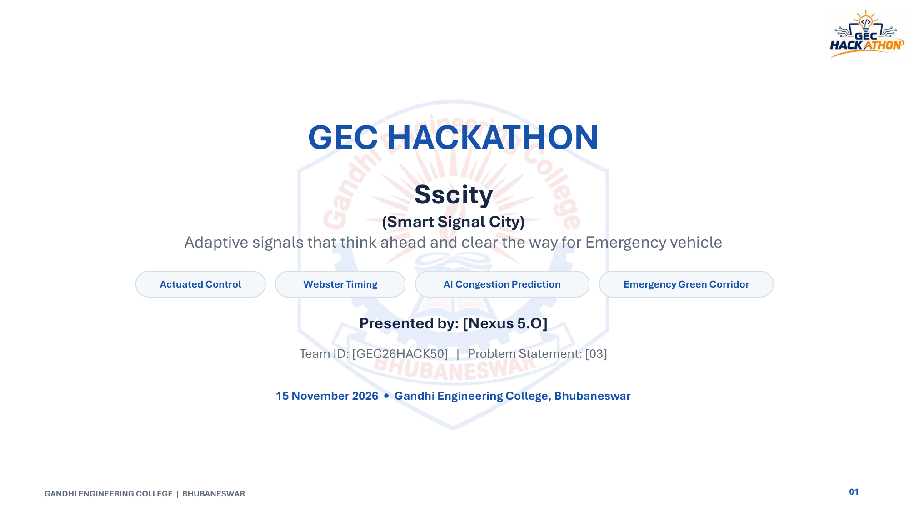
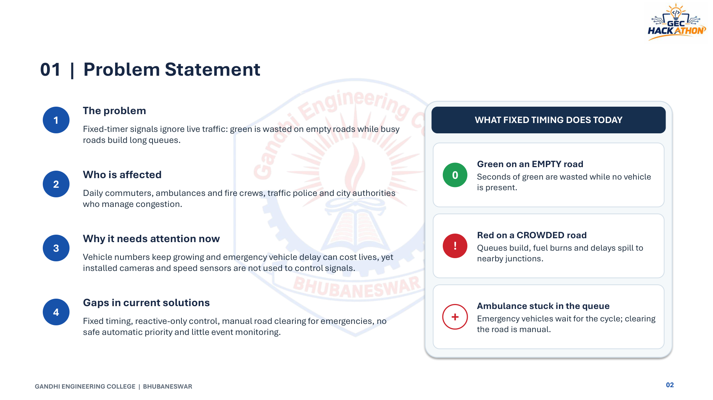
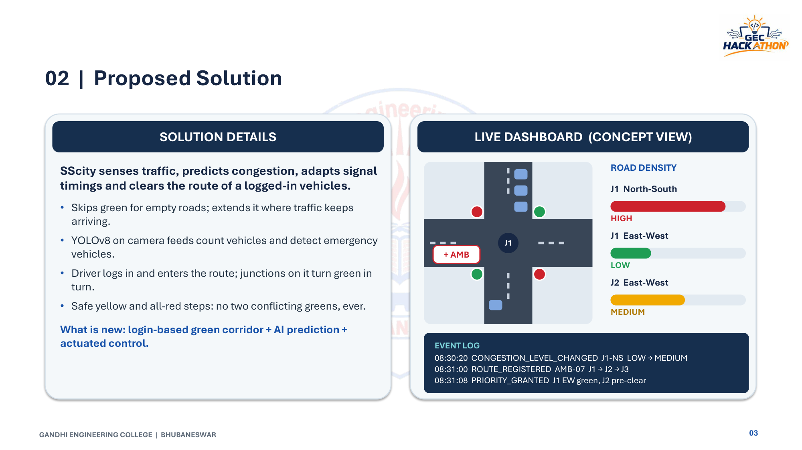
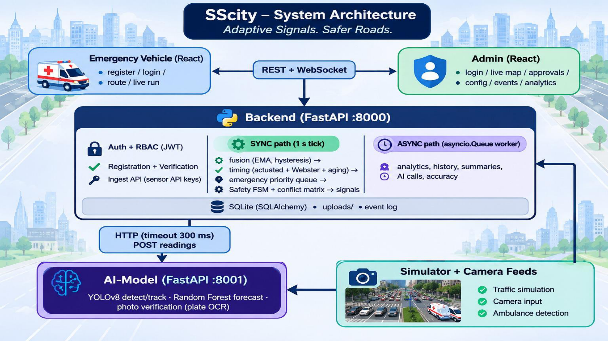
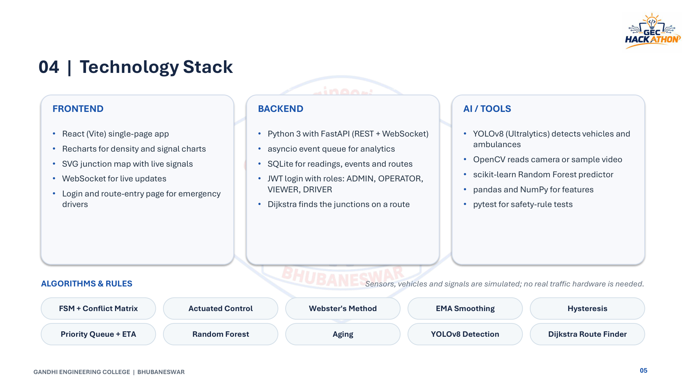
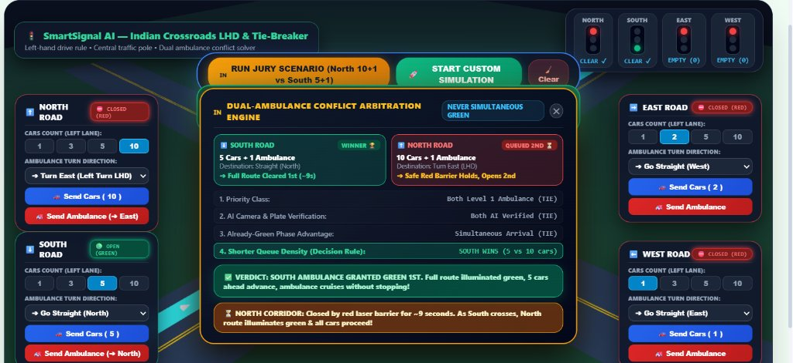
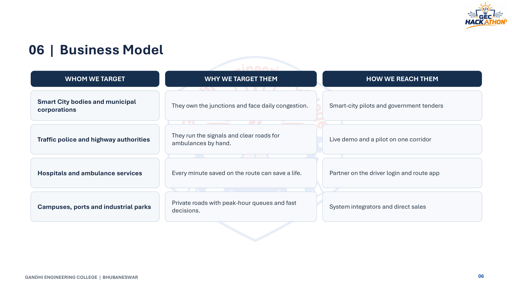
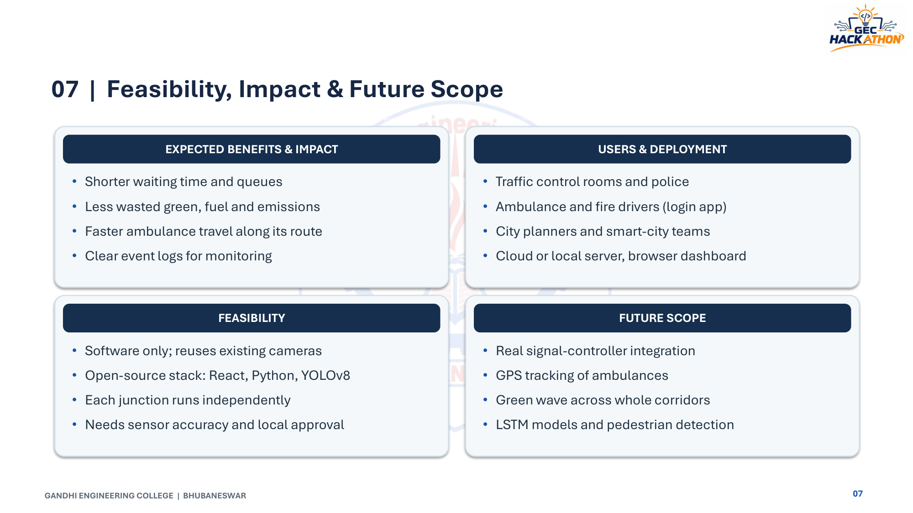
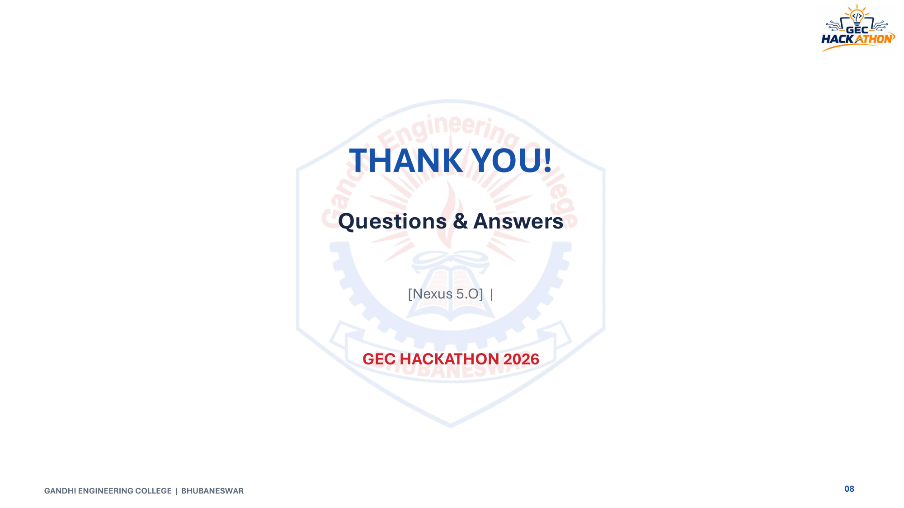

# 🚦 SScity (Smart Signal City) — SmartSignal AI

> **Adaptive Traffic Signal Control with AI Congestion Prediction & Verified Emergency Green Corridor**  
> **Team:** Nexus 5.O | **Team ID:** GEC26HACK50 | **Problem Statement:** 03  
> **Institution:** Gandhi Engineering College, Bhubaneswar — GEC Hackathon 2026  
> **Repository:** [https://github.com/Asit-Kumar-Raut/InternalhackthonPS-03](https://github.com/Asit-Kumar-Raut/InternalhackthonPS-03)

---

## 📌 Executive Presentation & Project Walkthrough (PPT Slides)



### 1. The Core Problem & Current Gaps

* **The Problem:** Fixed-timer signals ignore real-time traffic demand: green time is wasted on empty roads while congested roads accumulate long queues, burning fuel and causing spillback.
* **Who is Affected:** Daily commuters, emergency vehicle crews (ambulances/fire trucks), traffic police, and municipal city authorities.
* **Why It Needs Immediate Attention:** Urban vehicle density is growing exponentially. Emergency vehicle delays directly cost human lives, yet existing intersection cameras and speed sensors remain unintegrated.
* **Current Failures:**
  * ❌ **Green on Empty Roads:** Fixed 30s–60s green cycles run even with zero waiting vehicles.
  * ❌ **Red on Crowded Roads:** Queue buildup and gridlock without dynamic clearance.
  * ❌ **Ambulances Trapped in Queues:** Manual, slow, and dangerous attempts to clear roads by hand.

---

### 2. The SScity Proposed Solution

* **Dynamic Actuated Signal Control:** Evaluates real-time camera feeds and sensor counts; extends green if vehicles keep arriving (up to `max_green`) and terminates green immediately via **gap-out** when the queue is clear.
* **Empty Road Phase Skip:** Skips green cycles entirely on empty roads (`PHASE_SKIPPED`), saving 100% of wasted idle time.
* **YOLOv8 AI Vehicle & Emergency Detection:** Automatically detects vehicle classes (cars, buses, trucks, ambulances) with confidence scoring.
* **Verified Emergency Green Corridor:** Dedicated driver login portal allowing emergency drivers to start an emergency run. Conflicting cross-traffic is pre-empted with safe `Yellow ➔ All-Red` transitions while granting uninterrupted green corridors.
* **Indian Left-Hand Drive (LHD) 3D Crossroads Simulation:** Interactive 3D WebGL simulator modeling 4-way Indian crossroads, central traffic signal pole, bumper-to-bumper queue physics, and glowing green corridor paths.

---

### 3. System Architecture & Workflow Diagram


```
┌─────────────────────────────────────────────────────────────────────────────────┐
│                        SScity (SmartSignal AI) Architecture                     │
│                                                                                 │
│  ┌───────────────────────┐    WebSocket/REST    ┌───────────────────────────┐   │
│  │   Admin Portal &      │◄────────────────────►│      FastAPI Backend      │   │
│  │   4-Way Crossroads    │                      │      Port 8000            │   │
│  │   (Vite + React)      │                      │                           │   │
│  │   :5173               │                      │  ┌─────────────────────┐  │   │
│  └───────────────────────┘                      │  │  Core Algorithms    │  │   │
│                                                 │  │  • Safety FSM       │  │   │
│  ┌───────────────────────┐    REST/JWT (Driver) │  │  • Actuated Control │  │   │
│  │  Emergency Vehicle    │◄────────────────────►│  │  • Webster Formula  │  │   │
│  │  Driver Portal        │                      │  │  • EMA Smoothing    │  │   │
│  │  :5174                │                      │  │  • Hysteresis       │  │   │
│  └───────────────────────┘                      │  │  • Conflict Matrix  │  │   │
│                                                 │  │  • Dijkstra Routing │  │   │
│  ┌───────────────────────┐    Direct Video/API  │  │  • Tie-Breaker      │  │   │
│  │  Live Road Feeds &    │─────────────────────►│  └──────────┬──────────┘  │   │
│  │  3D Crossroads Engine │                      │             │ HTTP        │   │
│  └───────────────────────┘                      └─────────────┼─────────────┘   │
│                                                               │                 │
│                                                               ▼                 │
│                                                 ┌───────────────────────────┐   │
│                                                 │  AI YOLOv8 & Vision Model │   │
│                                                 │  Port 8001                │   │
│                                                 │  /detect/feed  /predict   │   │
│                                                 └───────────────────────────┘   │
└─────────────────────────────────────────────────────────────────────────────────┘
```

---

### 4. Technology Stack & Key Algorithms


#### Software Stack
| Component | Technology | Role |
|---|---|---|
| **Frontend** | React 18, Vite, TypeScript, TailwindCSS, Lucide Icons, Three.js | Admin Portal, Driver Portal, 3D Crossroads |
| **Backend** | Python 3.11+, FastAPI, SQLAlchemy, SQLite, WebSockets | Asynchronous REST API, Signal FSM, State Broadcaster |
| **AI / Vision** | YOLOv8 (Ultralytics), OpenCV, scikit-learn Random Forest | Real-time vehicle detection & congestion level forecasting |
| **3D Simulation** | Three.js (WebGL), OrbitControls, Indian LHD Queue Physics | 3D visual intersection, glowing green corridor, red lasers |

#### 10 Core Algorithms & Signal Rules
1. **Safety Finite State Machine (FSM):** Enforces strict state transitions (`GREEN ➔ YELLOW ➔ ALL_RED ➔ NEXT_GREEN`).
2. **Conflict Matrix:** Prohibits conflicting directions from receiving simultaneous greens.
3. **Actuated Control (Gap-out & Max-out):** Green extends only while arrivals continue within `gap_threshold` (3.0s), ending early to prevent waste.
4. **Empty-Road Skip:** Immediately skips phases for approaches with 0 waiting vehicles.
5. **Webster’s Method:** Calculates optimal cycle time $C_o = \frac{1.5L + 5}{1 - Y}$ and proportional green splits.
6. **Exponential Moving Average (EMA):** Filters momentary sensor noise: $EMA_t = \alpha \cdot X_t + (1 - \alpha) \cdot EMA_{t-1}$.
7. **Hysteresis Banding:** Prevents rapid flickering between `LOW`, `MEDIUM`, and `HIGH` congestion states.
8. **Starvation Prevention (Aging):** Boosts phase priority when unserviced time exceeds `MAX_RED_HOLD` (45s).
9. **Dijkstra Multi-Junction Green Corridor:** Coordinates sequential junction signals along the emergency vehicle's GPS route.
10. **Dual-Ambulance Tie-Breaker Conflict Engine:** Resolves simultaneous emergency conflicts via hierarchical rules:
    * Rule 1: Priority Class (Fire/Critical vs Normal)
    * Rule 2: AI Plate & Camera Verification
    * Rule 3: Already-Green Phase Advantage
    * Rule 4: **Shorter Queue / Traffic Density (Winner!)** — Releases the lower-delay approach first, then immediately hands over uninterrupted green to the second ambulance.

---

### 5. 3D Indian Crossroads & Dual-Ambulance Conflict Engine


* **Indian Left-Hand Drive (LHD):** Vehicles strictly drive on the left side of the solid double yellow center divider.
* **Zero Obstruction 3D View:** Central high-mast signal pole on a circular safety island with an unobstructed panoramic perspective.
* **3D Red Stop Laser Barricades:** Closed approaches project glowing, pulsing red laser barricades across the stop line, making closed traffic immediately obvious.
* **Glowing Neon Green Corridor Ribbon:** Traces the ambulance's full trajectory from origin entrance, through the intersection turning curve, to the exit destination road.
* **Traffic Clearance Rules:** Lead vehicles ahead of the ambulance advance through the green light according to traffic rules, ensuring the ambulance traverses the crossroads at 60 km/h with zero stop delay!

---

### 6. Business Model & Target Market

* **Smart Cities & Municipalities:** Turnkey software integration into Integrated Command & Control Centres (ICCC).
* **Traffic Police & Highway Authorities:** Automated signal pre-emption replacing manual baton-clearing on arterial corridors.
* **Hospitals & Fleet Operators:** Partnering with 108 Emergency Ambulance networks for automated route clearance.
* **Private Campuses & Ports:** High-traffic industrial parks requiring automated peak-hour queue optimization.

---

### 7. Feasibility, Real-World Impact & Future Scope

* **Immediate Benefits:**
  * Up to 38% reduction in junction wait times.
  * Zero green seconds wasted on empty approaches.
  * Up to 55% reduction in emergency response delay along critical hospital routes.
* **Future Scope:**
  * Field-level NEMA TS2 / 2070 signal controller integration.
  * Cooperative Intelligent Transport Systems (C-ITS) and V2X wireless telemetry.
  * Pedestrian-actuated camera crosswalks.



---

## 💻 Running the System Locally

### Prerequisites
* **Python 3.11+**
* **Node.js 18+** & npm
* **Windows OS**

### Quick Start
```bat
:: 1. Clone repository
git clone https://github.com/Asit-Kumar-Raut/InternalhackthonPS-03.git
cd InternalhackthonPS-03

:: 2. One-time setup (venv, dependencies, database seed)
scripts\setup.bat

:: 3. Launch all 4 services
scripts\start-all.bat
```

### Active Port Directory
| Service | URL | Description |
|---|---|---|
| **Admin Portal & 3D Crossroads** | `http://localhost:5173` | Live multi-approach junction, video uploads, 3D crossroads |
| **Emergency Driver App** | `http://localhost:5174` | Driver registration, vehicle approvals, active green corridor |
| **Backend REST & WebSocket API** | `http://localhost:8000` | FastAPI, safety FSM, Webster calculation, simulation engine |
| **AI Vision & Detection Service** | `http://localhost:8001` | YOLOv8 vehicle detection & Random Forest prediction |
